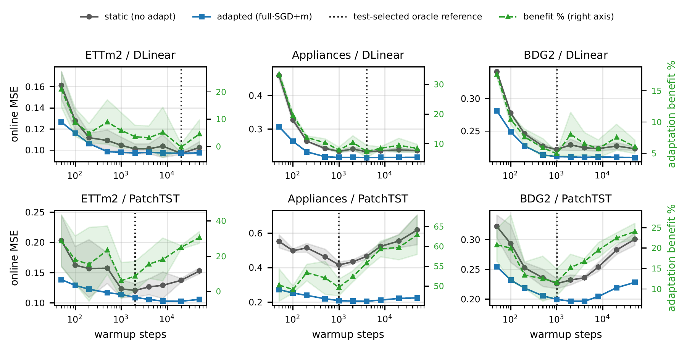
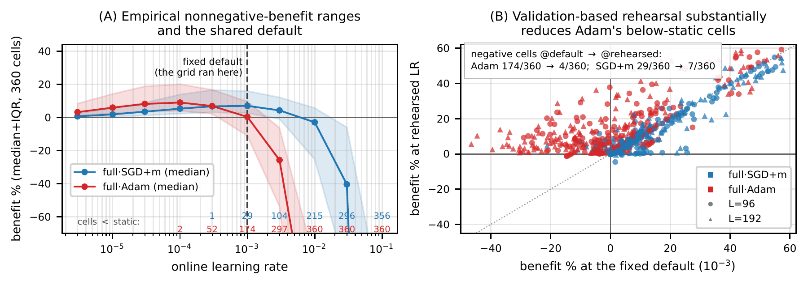

# How Evaluation Choices Shape the Measured Benefit of Online Adaptation in Time-Series Forecasting

Code, data and every reported number for

> T. Fujimoto and H. Nishi, "How Evaluation Choices Shape the Measured Benefit of Online
> Adaptation in Time-Series Forecasting: Warmup, Learning-Rate Selection, and Adaptation-State
> Memory," IEEE International Conference on Big Data (BigData), 2026.

The preprint [arXiv:2609.01126](https://arxiv.org/abs/2609.01126) carries the submission title,
"When Does Online Adaptation Pay on the Edge? A Leakage-Free Evaluation of Warmup, Learning-Rate
Selection, and Resource Trade-offs for Time-Series Forecasting".

The paper proposes no new adapter or optimizer. It measures how much the reported benefit of
online adaptation depends on how the comparison is set up, and gives a selection procedure that
uses only pre-drift data. The study covers six public multivariate streams (ETTh1/h2, ETTm1/m2,
UCI Appliances, BDG2 smart meters) and two backbones (DLinear, a compact PatchTST), with a
360-cell optimizer grid over five seeds.

## Contents

- [Findings](#findings)
- [Scope and limits](#scope-and-limits)
- [Quickstart](#quickstart)
- [Reproduction map](#reproduction-map)
- [Artifacts and reusable code](#artifacts-and-reusable-code)
- [Repository layout](#repository-layout)
- [Environment, data, license, citation](#environment)

## Findings

*Adaptation benefit* is `(MSE_static - MSE_adapt) / MSE_static` in %, measured as online MSE
over the streamed test region; `pp` is a difference between two such percentages.

### 1. The static baseline's warmup budget moves the estimated benefit

An under-warmed baseline underfits, so adaptation is credited with finishing base training. An
over-warmed baseline generalizes worse from the pre-drift segment to the drifted test window,
which raises the estimated benefit again. Over the 1,000–20,000-step range alone, the estimated
benefit moves by 3.0–18.8 pp across six dataset–backbone panels.



*Green (right axis): estimated adaptation benefit as the baseline's warmup budget varies. Gray
and blue: online test MSE of the static and adapted models.*

The pattern is two-sided on the seed-mean curve of every panel. With three seeds it is not
equally well resolved everywhere: over-warming adds +12.4 to +21.9 pp in the three PatchTST
panels but only +1.0 to +4.8 pp in the DLinear panels, which is comparable to the seed spread.
Both sides clear the seed spread only for PatchTST on ETTm2 and BDG2.

Early-stopping the warmup on a held-out slice of the most recent pre-drift data lands within
+3.4 pp of a test-selected oracle reference in all six panels, without touching test data.

### 2. A shared default learning rate biases the optimizer comparison

At the usual `lr=1e-3`, Adam wins 45 of 360 cells against SGD with momentum and falls below
the static baseline in 174 of them. Selecting each optimizer's online rate by *rehearsing*
adaptation on the same held-out pre-drift slice changes the picture: Adam wins 310 of 360
cells, and 4 of its cells fall below static. Averaged over seeds, Adam's margin is positive in
61 of 72 configurations, with a median of +1.4 pp. The default-rate result reflects where
`1e-3` sits in each optimizer's usable rate range more than optimizer quality.



*(A) Benefit across the rate grid, with the count of cells below static at each rate along the
bottom. (B) The same cells at the shared default versus at the rehearsed rate.*

Rehearsal is not a stability guarantee. SGD with momentum still lands below static in 7 of 360
cells at its rehearsed rate, because a rate can win on the calmer pre-drift slice and
destabilize on the drifted stream.

### 3. Parameter-efficient adaptation keeps most of the benefit at a fraction of the state

On Appliances/PatchTST, calibration-only Adam reaches +44.5% benefit with 204 kB of adaptation
state, against +52.5% at 1,028 kB for full-model Adam: about 5x less state for about 85% of the
benefit. Several parameter-efficient variants are nondominated on the adaptation-state-memory
axis. Whether they replace full-model adaptation or only compete with it depends on the
dataset.

### 4. Smart-meter gains depend on the meter-selection rule

On BDG2 with PatchTST, the 15 least-missing meters of one site report +13.5%, and the 15
most-missing meters of the same site report +42.8%. Much of the second figure is scored on
forward-filled readings, so it describes the imputed stream and not observed consumption.
Fleet-scale estimates should state their meter-selection and imputation rules.

### Protocol check

All results use non-overlapping windows at stride equal to the horizon: each target is scored
before it can enter a gradient. To verify the implementation, the known leak of overlapping
windows is reproduced against a delayed-adaptation control. It raises the reported benefit by
+11.3 to +39.8 pp and reverses its sign on ETTh2/PatchTST (+24.2% leaky, -15.6% delayed).

## Scope and limits

- **Edge deployment is the motivation, not a measured result.** Adaptation-state memory is
  counted (gradient buffers plus optimizer state; weights and activations excluded). Update
  latency is measured on an A100 at batch size 1. Target-device memory, latency and energy
  remain to be measured.
- **The held-out slice costs freshness.** The validation slice is never trained on and there is
  no refit after selection, so the static baseline is one validation span older than it could
  be. A refit control is not included.
- **The optimizer conclusion concerns one pair**, SGD with momentum and Adam, on two backbones
  and six streams, four of which are ETT benchmarks.

## Quickstart

No number in the paper is typed by hand. Each one is a LaTeX macro generated from the shipped
artifacts, and each figure is drawn from them.

### Numbers and figures, without a GPU (seconds)

```bash
pip install -r requirements.txt
bash experiments/tsf_edge/data/get_data.sh   # download only (see the note below)
python experiments/tsf_edge/gen_macros.py    # -> results/tsf_edge/macros.tex (856 macros)
python experiments/tsf_edge/paper_figs.py    # -> results/tsf_edge/*_paper.pdf (5 paper figures + 1 supplementary)
```

`get_data.sh` is needed even though this step uses no GPU. Five of the 856 macros describe the
composition of the Appliances stream (`\ApplChannels` and related) and are computed from
`appliances.csv` itself. Without that file, `gen_macros.py` prints
`WARNING: dataset composition skipped` and emits 851 macros; the paper references four of the
missing five, so `main.tex` would not compile.

### Rerunning the experiments (GPU)

```bash
pip install -r requirements.txt
bash experiments/tsf_edge/data/get_data.sh   # ETT x4 + UCI Appliances (bdg2*.csv are shipped)
python experiments/tsf_edge/combined_grid.py # e.g. the 360-cell grid
```

## Reproduction map

| Paper item | Script | Artifact | Runtime (1x A100) |
|---|---|---|---|
| Fig. 1 + Table I (C1a warmup sensitivity, 2x3 panels) | `warmup_confound.py` | `warmup_confound_sgdm.json` | ~1.5 h |
| Fig. 2 (C1c validation-only selection, same 2x3 grid as Fig. 1) | `validation_protocol.py` | `validation_protocol_sgdm.json` | ~1.5 h |
| C1 leak-inflation numbers (the stride-1 alternative) | `leakage_check.py` | `leakage_check_sgdm.json` | ~10 min |
| Fig. 3 + Table II (C2 learning-rate selection: default / rehearsed / oracle readings) | `lr_fairness.py` (`--L/--H/--seeds`) | `lr_fairness.jsonl` (10-rate grid over the 360-cell design) | ~16 h total |
| C2 shared-default statistics at scale | `combined_grid.py` | `grid.jsonl` (360 cells) | ~13 h |
| C2 guard: are collapsed high rates a startup transient or a steady-state failure? | `lr_transient_check.py` | `lr_transient.json` | — |
| Fig. 4 (C3 accuracy--memory--compute frontier, 5 seeds) | `frontier_seeds.py` | `frontier_seeds.jsonl` (30 points x 5 seeds; `frontier_data.json` = the retired seed-0 run) | ~30 min |
| Per-update wall-clock (Fig. 4 compute axis) | `frontier_timing.py` | `frontier_timing.json` | ~2 min |
| Fig. 5 (staleness: one row of dataset panels, hue = optimizer, shade = schedule) | `staleness.py` / `staleness.py --strategy full_adam` | `staleness_patchtst_full_sgdm.json` / `staleness_patchtst_full_adam.json` | ~15 min each |
| Table III (BDG2 meter-selection & scale study) | `prep_bdg2_subsets.py`, then `lr_fairness.py --datasets bdg2_fox,bdg2_panther,bdg2_rat_worst,bdg2_rat_all,bdg2_fleet` | `bdg2_*.csv` + the 30 subset rows in `lr_fairness.jsonl` | ~40 min (15-meter subsets); hours for site/fleet |
| Per-update wall-clock vs channel count (the scale numbers in §IV-C) | `scale_timing.py` | `scale_timing_sgdm.json` | — |
| Supplementary: the warmup confound across four adaptation strategies (not in the paper — cut for page budget; figure `m6_strategies_paper.pdf`) | `m6_strategies.py` | `m6_strategies.json` (figure), `m6_strategies_sgdm.json` (macros) | ~2 h |
| Every number in the paper | `gen_macros.py` | `macros.tex` (856 macros) | seconds, no GPU |
| Every figure in the paper | `paper_figs.py` | `*_paper.pdf` | seconds, no GPU |

Runtimes are the measured wall-clock of the paper's runs on one A100; `—` means not recorded.

Two scripts are shipped but superseded, kept so the earlier readings stay reproducible:
`frontier.py` (single-seed frontier, replaced by `frontier_seeds.py`) and `regime_figure.py`
(standalone learning-rate figure, replaced by `paper_figs.regime_paper`). Result files without
the `_sgdm` suffix are the retired momentum-free SGD readings; the paper reads the `_sgdm`
files.

## Artifacts and reusable code

- **The protocol as working code.** `online_eval.py` provides `stream_eval` (leakage-free
  streaming), `warm_and_select` (validation-selected warmup) and `select_online_lr`
  (rehearsal-based rate selection). They apply unchanged to another stream.
- **`grid.jsonl`** — one JSON line per cell (6 datasets x 2 backbones x H in {24,48,96} x
  L in {96,192} x 5 seeds = 360): the validation-selected warmup, static and adapted results
  for both optimizers at the default rate, optimizer-state bytes, and three
  optimizer-independent probes (P1 noise, P2 gradient cosine, P3 drift; P3 is post hoc and uses
  the test region).
- **`lr_fairness.jsonl`** — 390 lines: the same 360 cells plus 30 BDG2 meter-selection rows
  (5 subsets x 2 backbones x 3 seeds at H=24, L=96) for Table III. Each line carries the full
  10-point online-rate sweep (a `{1,3}x10^k` grid from `3e-6` to `1e-1`) per optimizer, with
  validation-rehearsal MSE, test MSE and benefit at every rate, and the rehearsed and
  test-oracle readings.

These two files are enough to re-derive the paper's statistics, or to test a new hypothesis,
without a GPU.

## Repository layout

```
experiments/tsf_edge/    harness and generators (see the reproduction map)
    online_eval.py       models, streaming protocol, selection procedures
    gen_macros.py        result files -> macros.tex
    paper_figs.py        result files -> *_paper.pdf
    data/                bdg2*.csv shipped; ETT and Appliances via get_data.sh
results/tsf_edge/        result artifacts, generated macros and figures
docs/figs/               README figures, rendered from the tracked *_paper.pdf
```

Files named `stage0*`, `online_optimizers.py`, `petsa_*`, `macros_ext.tex` and the remaining
figures and tables belong to separate work and are not described here. `online_eval.py` imports
`online_optimizers.py`, so that file is required.

## Environment

Python 3.11 and the versions pinned in `requirements.txt` (torch 2.7.0+cu126 on one NVIDIA A100
80GB, CUDA 12.5). Nearby versions are expected to work. Exact numerical reproduction assumes
the pinned versions and the shipped data files (`experiments/tsf_edge/data/checksums.sha256`).

## Data

`experiments/tsf_edge/data/README.md` lists sources, licenses and the BDG2 preprocessing
specification. `bdg2.csv` and the five BDG2 subsets (processed from the MIT-licensed Building
Data Genome 2 corpus) are shipped. ETT and UCI Appliances are downloaded by `get_data.sh` and
verified against the checksums of the files used in the paper.

## License

Code: MIT (see `LICENSE`). Datasets keep their original licenses (see the data README).

## Citation

```bibtex
@inproceedings{fujimoto2026evaluation,
  author    = {Fujimoto, Takumi and Nishi, Hiroaki},
  title     = {How Evaluation Choices Shape the Measured Benefit of Online Adaptation in
               Time-Series Forecasting: Warmup, Learning-Rate Selection, and
               Adaptation-State Memory},
  booktitle = {IEEE International Conference on Big Data (BigData)},
  year      = {2026}
}
```

Pages and DOI will be added once the proceedings are published. To reference exact numbers,
cite the commit hash you used.
